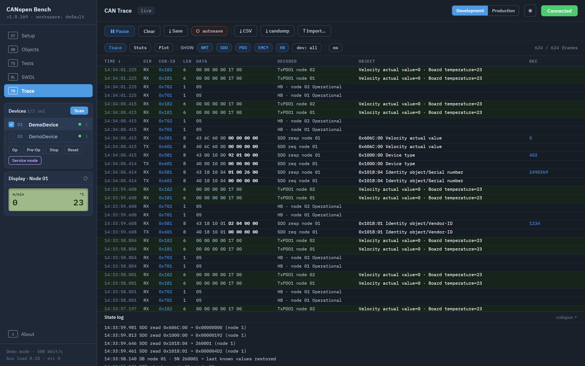
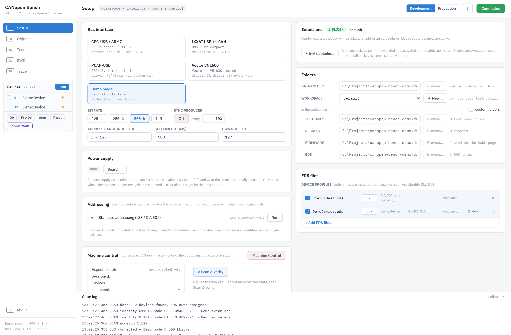
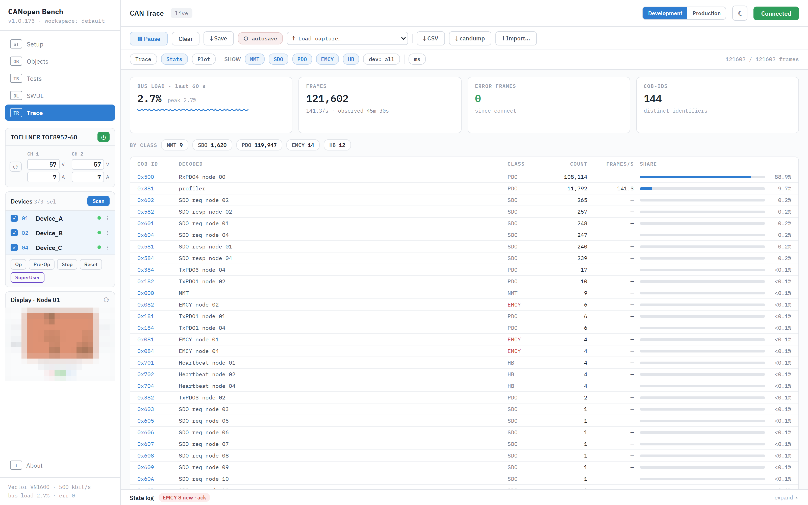
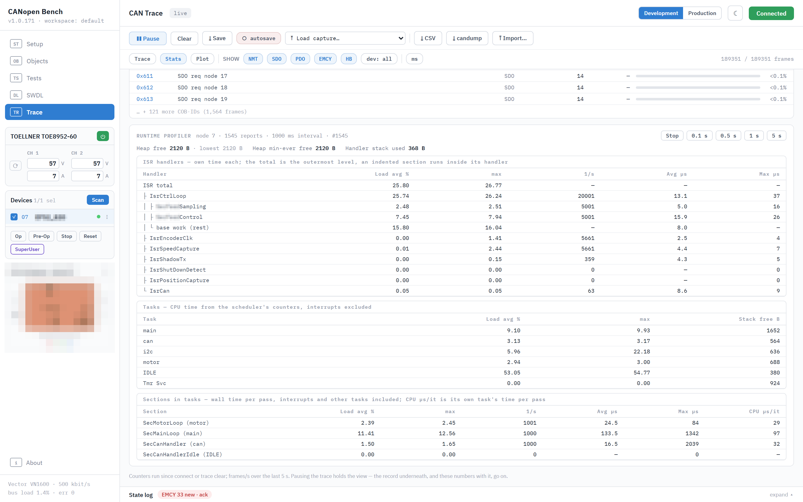
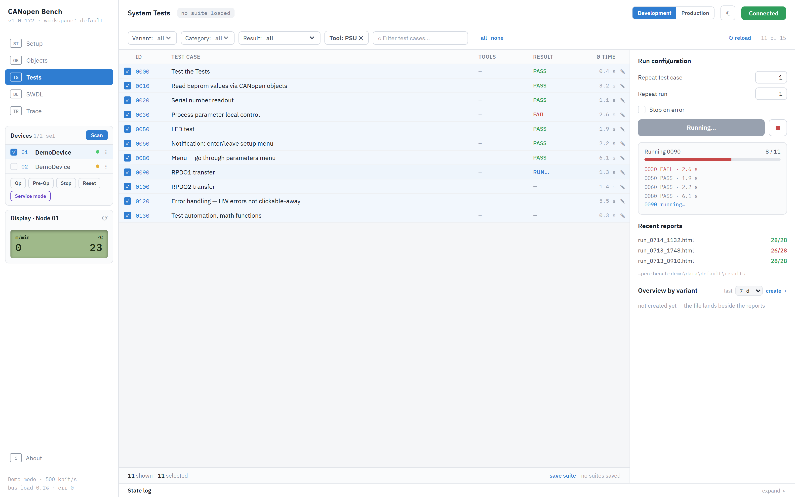
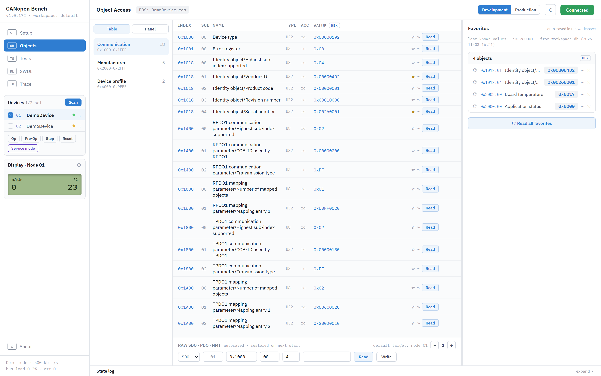
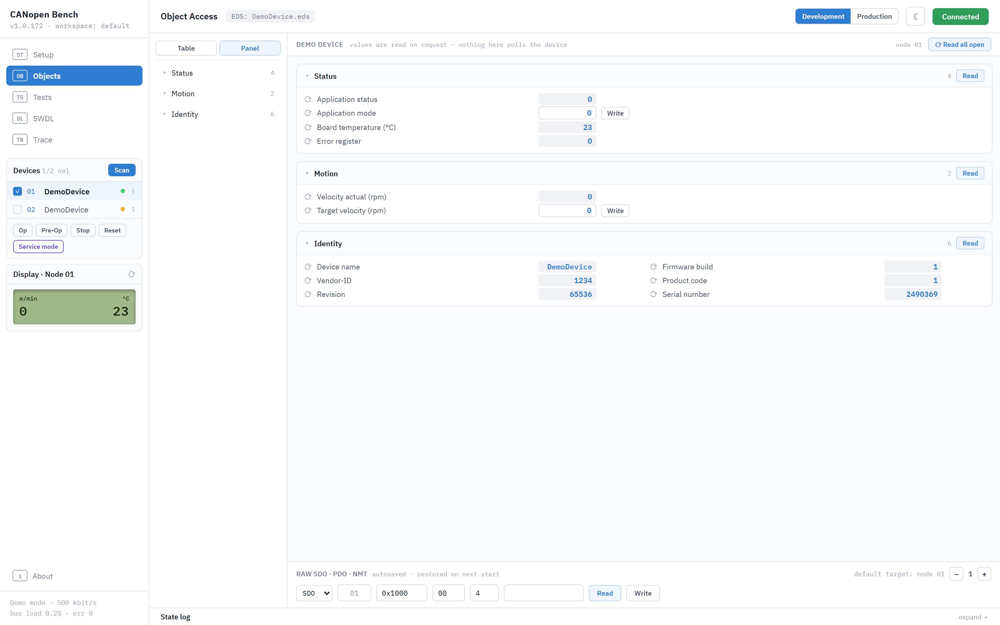
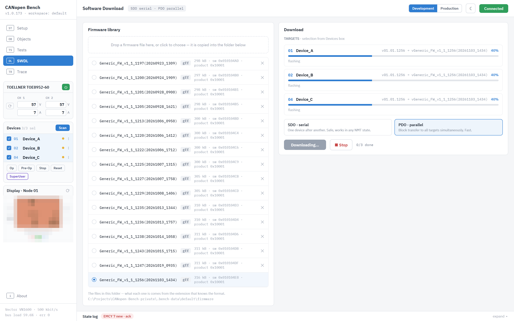

# CANopen Bench

[](https://github.com/NobseVomBerg/CANopen-Bench/actions/workflows/ci.yml)
[](https://pypi.org/project/canopen-bench/)
[](https://pypi.org/project/canopen-bench/)
[](https://github.com/NobseVomBerg/CANopen-Bench/blob/main/LICENSE)

Web tool to test and control CANopen devices on a hardware bench — scan,
object access, system tests, firmware download and a live CAN trace,
driven by the devices' EDS files. Python backend (Starlette +
canopen/python-can), no-build frontend (Preact/HTM), one self-contained
workspace folder per bench.

<picture>
  <source media="(prefers-color-scheme: dark)" srcset="https://raw.githubusercontent.com/NobseVomBerg/CANopen-Bench/main/docs/img/trace-dark.png">
  
</picture>

## Try it — no hardware needed

```bash
pip install canopen-bench
canopen-bench                  # → http://127.0.0.1:8000
```

No virtualenv needed to just run it. From a clone, `pip install .`
installs the same thing from the checkout — without `-e`, which installs
the package for editing, and that is what `## Development` below is for.

`canopen-bench` is a shortcut the install writes; the module runs just as
well by itself, and from a clone's root it runs that checkout:

```bash
python -m canopen_bench                       # same thing, same options
python -m canopen_bench --port 8001 --host 0.0.0.0
```

Two reasons to prefer it. It runs *this* directory rather than whatever
`canopen-bench` happens to point at, which matters as soon as a second
copy or a second virtualenv is around. And it needs only the
dependencies, not the package itself: `pip install starlette uvicorn
websockets canopen python-can pyyaml` (the `dependencies` list in
`pyproject.toml`, plus `cob-cpcusb` for a CPC-USB adapter) and a clone is enough — worth knowing on a bench
machine where you would rather not install anything.

Note the underscore: the distribution is `canopen-bench`, the module is
`canopen_bench`. `python -m canopen-bench` cannot work — a hyphen is not
valid in a Python module name.

Pick **Demo mode** on the Setup page, **Connect**, **Scan**: virtual
devices are generated from the bundled `canopen_bench/seed/DemoDevice.eds`
(installed into
the workspace on first run). SDO reads/writes are answered from the EDS
object dictionary — including realistic aborts on out-of-range writes —
and every access shows up in the Trace like real bus traffic.

An AI assistant can drive it as well: the running bench is an MCP server
at `http://127.0.0.1:8000/mcp`, entered once in Claude Code or GitHub
Copilot ([docs/mcp.md](docs/mcp.md)).

<picture>
  <source media="(prefers-color-scheme: dark)" srcset="https://raw.githubusercontent.com/NobseVomBerg/CANopen-Bench/main/docs/img/setup-dark.png">
  
</picture>

## Features

- **Setup** — adapter/bitrate/scan-range, EDS registry with identity
  matching (0x1018), machine control: adopt the bench's expected state,
  scan & verify against it, re-address via exchangeable flow files.
- **Production view**: a switch to a reduced bench for the end of a line,
  showing the procedures a vendor package ships (flows marked
  `grade: production`, e.g. flash a board) with their firmware choices,
  a Start button, instructions and progress.
- **Objects** — EDS object browser with read/write, favorites
  (auto-saved), typed RAW rows (SDO / PDO / NMT with per-row node-id),
  last-known values per device serial number.
- **Tests** — declarative YAML test cases
  (`docs/ablaeufe/testfall-format.md`, examples in
  `examples/testcases/`) executed for real against the selected device.
  A run leaves HTML reports behind: one file per case, one summary, and a JSON
  sibling. From those, "Overview by variant" folds the last so many days
  into one collapsible section per hardware variant — runs, successes
  and last verdict per case — which is how you tell one broken variant
  from a broken device family.
- **Bench instruments** — a remote-controllable lab power supply is set
  from the Setup page and from a test case (`psu` step), which is what
  keeps an under-voltage case automated instead of asking an operator to
  turn a knob. Serial port, `pip install ".[serial]"`; drivers in
  `canopen_bench/instruments/`.
- **SWDL** — firmware download; the files come from a folder you point at
  (often the firmware project's build output, drag & drop works too), and
  what each one is comes from the extension that knows the format.
  Download protocols are manufacturer-specific and ship as vendor
  extension packages (see the note on the page).
- **Trace** — live monitor, newest frame at the top, scrollable back
  through the whole 200k-frame ring buffer or an opened capture rather
  than a screenful. Class + device filters, ms/µs timestamps, capture
  save/load, and autosave — every recorded frame written to a capture
  file as it arrives, kept for two weeks, for the endurance runs that are
  longer than the ring is deep.
- **Web API** — the browser is only a client: every button is a
  `POST /api/action {action, params}`, and `GET /api/state` returns what
  the pages show as JSON. A script, or an AI agent with nothing but curl,
  drives the bench the same way — scan, read objects, start a run, go
  through the trace — which automates what no test case covers: a quick
  investigation, a check across many devices, a report put together on
  the spot. The actions are the `act_*` methods in `canopen_bench/core.py`.
  No authentication, so the port stays on a trusted network.
- **MCP server** — the same bench at `/mcp` for AI assistants (Claude
  Code, GitHub Copilot): tools for devices, supply, test runs, firmware
  download and the trace, which describe themselves to the assistant
  ([docs/mcp.md](docs/mcp.md)).

## Screenshots

Stats, profiler and SWDL are from a real bench with a vendor plugin
installed — device, product and a few handler names replaced with
generic ones, the display pixelated. Tests and Objects are demo mode, as `pip install
canopen-bench` gives it. Some of what the real bench shows is the
plugin's, not the core's: the runtime profiler is a statistics block it
adds, the display card in the sidebar is its device panel, frame names
beyond CANopen are its trace decoders, and the firmware format and
download protocol are its SWDL strategy (`docs/extending.md` has the
hooks).

<table>
  <tr>
    <td width="50%">
      <picture>
        <source media="(prefers-color-scheme: dark)" srcset="https://raw.githubusercontent.com/NobseVomBerg/CANopen-Bench/main/docs/img/stats-dark.png">
        
      </picture>
      <br><sub>Trace › Stats: bus load, frames by class and by COB-ID</sub>
    </td>
    <td width="50%">
      <picture>
        <source media="(prefers-color-scheme: dark)" srcset="https://raw.githubusercontent.com/NobseVomBerg/CANopen-Bench/main/docs/img/profiler-dark.png">
        
      </picture>
      <br><sub>Runtime profiler (plugin): ISR, task and section load as the device reports it</sub>
    </td>
  </tr>
  <tr>
    <td width="50%">
      <picture>
        <source media="(prefers-color-scheme: dark)" srcset="https://raw.githubusercontent.com/NobseVomBerg/CANopen-Bench/main/docs/img/tests-dark.png">
        
      </picture>
      <br><sub>Tests: a run in progress, one case failed so far; on the right the HTML reports of earlier runs</sub>
    </td>
    <td width="50%">
      <picture>
        <source media="(prefers-color-scheme: dark)" srcset="https://raw.githubusercontent.com/NobseVomBerg/CANopen-Bench/main/docs/img/objects-dark.png">
        
      </picture>
      <br><sub>Objects: the EDS as a table, values read, favorites on the right</sub>
    </td>
  </tr>
  <tr>
    <td width="50%">
      <picture>
        <source media="(prefers-color-scheme: dark)" srcset="https://raw.githubusercontent.com/NobseVomBerg/CANopen-Bench/main/docs/img/panel-dark.png">
        
      </picture>
      <br><sub>Objects › Panel: the same objects grouped by a panel file (<code>docs/panel-format.md</code>)</sub>
    </td>
    <td width="50%">
      <picture>
        <source media="(prefers-color-scheme: dark)" srcset="https://raw.githubusercontent.com/NobseVomBerg/CANopen-Bench/main/docs/img/swdl-dark.png">
        
      </picture>
      <br><sub>SWDL (plugin): one firmware file to three devices in parallel</sub>
    </td>
  </tr>
</table>

## Hardware

Which adapters the tool talks to, via python-can. Names are the
manufacturers' — see the trademark note in `THIRD-PARTY-NOTICES.md`;
this project is not affiliated with any of them, and the table says what
has been exercised, not what is warranted.

| Adapter | Driver | State |
|---|---|---|
| IXXAT USB-to-CAN | VCI4 (Windows) | in regular use on the author's bench |
| PCAN-USB | PCANBasic | wired up, never run — no such adapter here |
| Vector VN1600 (VN1610/VN1630) | XL driver (Windows) | run against a VN1630 |
| CPC-USB/ARM7 | `cob-cpcusb` over pyusb/libusb (Windows: WinUSB via Zadig) | comes with the install; tested against a simulated USB device |
| SocketCAN (Linux): PCAN-USB, Kvaser, candleLight/CANable, CPC-USB, … | the kernel's own (`peak_usb`, `kvaser_usb`, `gs_usb`, `ems_usb`) | run against a virtual `vcan` interface in CI, never against a device |
| Demo mode | — | no hardware, EDS-driven simulation |
| other adapters | via plugin packages | separate install |

Everything above demo mode goes through python-can's own backends, so
adapter support tracks python-can. The Vector entry exists because plain
CAN on a VN1600 needs only Vector's freely downloadable XL driver — the
CANoe/CANalyzer licences are for their applications, not for talking to
the hardware — and a lot of that hardware outlives the software budget
it was bought with. Bring-up checklists live in
`docs/ablaeufe/A-01-verbinden.md` and `A-02-scan.md`.

**SocketCAN** covers, in one card, every adapter whose Linux kernel driver
turns it into a network interface (`can0`); the card is shown on Linux
only. The operating system owns the bitrate there, not the bench, so it is
set on the host, by root:

```bash
sudo ip link set can0 up type can bitrate 500000
```

On connect the bench reads the interface's bitrate back and refuses one
that differs from the one picked on the Setup page, or an interface that
is down or missing, with the `ip` line that fixes it — it does not set
anything itself. `can0` queues only 10 frames by default; a burst (a
firmware download) fills that at once, and the bench waits it out, but
`sudo ip link set can0 txqueuelen 1000` gives it room.

## Workspaces

Every subfolder of the data folder is one workspace: its own sqlite db,
EDS files, trace captures and flow files. Create and switch workspaces on
the Setup page; copy a folder to clone or back up a bench. The data folder
is chosen under Setup > Folders and kept per user (`%APPDATA%\CANopen-Bench`,
`~/.config/canopen-bench`), so the bench finds it wherever it is started
from; on the first start it is `./data` where there is one, else
`~/CANopen-Bench`. `--data <folder>` names it for one start (a second bench
beside the everyday one, a mounted Docker volume). `--db <path>` remains as an expert override for a
single explicit database file.

Flows and EDS files a package ships are written over in the workspace on
every start, like its test cases: an update arrives without anybody
looking for the old copy. A file of one's own goes in under another name.

## Docker

```bash
docker run -p 8000:8000 -v canopen-bench:/data ghcr.io/nobsevomberg/canopen-bench
```

Every version that goes to PyPI is also an image on GHCR (`:latest`, and
the version, e.g. `:1.0.173`), for amd64 and arm64 — a Raspberry Pi on
the bench included. `docker build -t canopen-bench .` builds the same
from a clone.

All workspaces live on the `/data` volume. Demo mode works out of the
box. Of the adapters, a container reaches those whose driver it carries,
and those the host's kernel drives:

- **SocketCAN** on a Linux host: bring `can0` up on the host, with its
  bitrate (see Hardware), and start the container in the host's network
  so it sees that interface — the port is then the host's own, no `-p`:

  ```bash
  docker run --network host -v canopen-bench:/data ghcr.io/nobsevomberg/canopen-bench
  ```

  That reaches a PCAN-USB, Kvaser, candleLight/CANable or CPC-USB without
  a driver in the image. Not yet tried with a device.
- **CPC-USB** on a Linux host: either through SocketCAN, above, with the
  kernel's `ems_usb` left loaded — or `--device=/dev/bus/usb` hands the
  USB bus in for the bench's own driver, libusb is in the image. For that
  one `ems_usb` has to let go of the device: `sudo modprobe -r ems_usb`
  frees it until the next replug, a line `blacklist ems_usb` in
  `/etc/modprobe.d/` for good. Neither way tried in a container yet.
- **PCAN**: PCANBasic is not in the image, but on a Linux host the
  kernel's `peak_usb` makes the adapter `can0` — use SocketCAN.
- **IXXAT, Vector**: their drivers are not in the image and exist only
  for Windows. Install the bench natively there
  (`pip install canopen-bench`).
- **Docker Desktop** on Windows or macOS cannot hand a USB device to a
  container; there too, install with pip.

The tool has no authentication — keep the port on a trusted network (see
`SECURITY.md`).

## Extending

Vendor- and device-specific functionality (adapter cards, EDS seeds,
firmware catalogs, addressing procedures with session identities, demo
protocol simulations, trace decoders, EMCY code tables, custom
test-step primitives, SWDL strategies) lives in separate pip packages
registered under the
`canopen_bench.plugins` entry-point group — installing one activates it.
In multi-workspace mode this needs no shell at all: Setup > Extensions
installs a plugin package (`.whl`) straight from the browser, active
immediately — its own dependencies are not installed with it, and the
state log names any this Python lacks, with the pip command that adds
them. Guide with hook table and a minimal example:
`docs/extending.md`; API: `canopen_bench/plugin.py`. A complete worked
example ships in this repo under
[`plugins/cob-cpcusb/`](https://github.com/NobseVomBerg/CANopen-Bench/tree/main/plugins/cob-cpcusb) — python-can driver plus
adapter card, its own tests, MIT. It is a separate distribution that
`pip install canopen-bench` brings along; on its own
(`pip install cob-cpcusb`) it is a python-can backend for anyone.

## Documentation

- `IMPLEMENTATION.md` — architecture and design decisions
- `CONTRIBUTING.md` — dev setup, test conventions, what goes where
- `docs/extending.md` — plugin guide
- `docs/mcp.md` — the MCP server for AI assistants
- `docs/ablaeufe/` — operational sequence specs (German)
- `docs/ablaeufe/testfall-format.md` — YAML test-case format

## Development

```bash
python -m venv .venv && . .venv/bin/activate
pip install -e ".[dev]"         # editable + pytest/ruff
pytest                          # core suite
```

`CONTRIBUTING.md` has the rest: what CI checks, where things belong, the
versioning rule.

Behind a TLS-inspecting corporate proxy, pip fails with
`CERTIFICATE_VERIFY_FAILED` on pypi.org: the proxy's CA is trusted by the
operating system but not by the certificate bundle Python ships. On
pip 23.2+, `--use-feature=truststore` makes pip use the OS store
instead. On older pip that route is closed — it needs the `truststore`
package, which also comes from pypi.org — so export the OS root
certificates to a PEM and point pip at it with `--cert`, or set it once
with `pip config set global.cert <file>`. Either way certificate
verification stays on.

## License & author

Core application: MIT (`LICENSE`). Plugin packages are licensed
independently — vendor plugins proprietary, `cob-cpcusb` MIT.
Bundled and depended-on third-party components, and the trademark note
(CANopen® and CiA® belong to CAN in Automation e.V.; this is not a
CiA-certified or CiA-affiliated tool), are listed in
[`THIRD-PARTY-NOTICES.md`](https://github.com/NobseVomBerg/CANopen-Bench/blob/main/THIRD-PARTY-NOTICES.md).

Created by NobseVomBerg · [unsix.de](https://unsix.de) ·
[GitHub](https://github.com/NobseVomBerg/CANopen-Bench)
